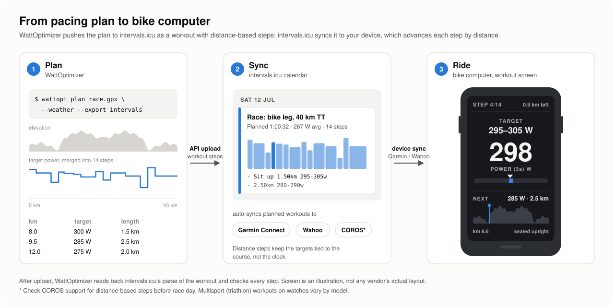

# WattOptimizer

**Open-source optimal pacing for time trials and triathlon bike legs.**

Commercial race-pacing tools are closed black boxes. WattOptimizer treats a course
as a trajectory-optimisation problem you can read, audit and extend: rider
mechanics, road gradient, cornering, a spatio-temporal wind field and two
bioenergetic state equations (W′ balance and glycogen) are solved together for the
power profile that **minimises finish time** while arriving at T2 with the reserves
you choose instead of an empty tank.

New to terms like CP, W′ or CHO? See the [Glossary](#glossary).

```text
Course     WattOptimizer demo 40 km TT: 40.0 km, +381 m
Finish     1:00:32  (avg 267 W = 95% CP, 39.7 km/h, 969 kJ)
Reserves   W'bal 5.0 kJ (25%), glycogen 322 g at the finish
Position   upright 2% of the time, 2 position changes (optimised; rounding to aero/upright cost 0.0 s)
Even pace  273 W constant meets the same reserves in 1:02:05 -> plan saves 93 s

         km  grade  target  speed  wind  split  elapsed  Wbal  CHO  pos
                 %       W   km/h   m/s                    kJ    g
-----------------------------------------------------------------------
  8.0-  9.0    6.9     325   17.4   3.0   3:28    16:21   0.2  446  mixed
  9.0- 10.0    2.0     240   24.2   3.0   2:29    18:49   4.0  441  aero
 ...
 30.0- 31.0   -2.0     215   58.4  -3.0   1:02    49:36   5.1  352  aero
```

## Quick start

```bash
git clone https://github.com/fregocap/wattoptimizer.git && cd wattoptimizer
pip install -e ".[fit,plot]"          # or: uv sync --all-extras

wattopt demo-course demo.gpx           # synthetic 40 km out-and-back TT
wattopt plan demo.gpx -c examples/athlete.toml \
    --wind-speed 5 --wind-from 90 --plot plan.png --csv plan.csv
```

With a real course and the forecast for race morning (Open-Meteo, no API key; past
dates use the historical archive so you can re-analyse a race):

```bash
wattopt plan ironman_bike.gpx -c me.toml --weather --start 2026-07-12T07:30+02:00
```

From Python:

```python
from wattoptimizer import Athlete, RaceSpec, ConstantWind, load_course, optimize
from wattoptimizer.report import splits, format_table

course = load_course("course.gpx", ds=100)
plan = optimize(course, Athlete(cp=300, w_prime=22_000),
                RaceSpec(w_prime_final=0.3, glycogen_final=250),
                wind=ConstantWind(speed=4, direction_from=225))
print(format_table(splits(plan)))
```

## The model

Distance $s$ is the independent variable. The course is a curve in $\mathbb{R}^3$,
resampled to $n$ segments of length $L_k$ with grade angle $\theta_k$ and heading
$\psi_k$.

**Mechanics.** For speed $v$, power $P$ and wind $\vec W(x, t)$ projected onto the
direction of travel (head wind $w = -\vec W\cdot\hat\tau$, scaled from 10 m to rider height),

$$
m_\text{eff}\, v \frac{dv}{ds} = \frac{\eta P}{v}
  - \tfrac12 \rho(z)\, C_dA\, (v + w)\,|v + w|
  - m g\,(C_{rr}\cos\theta + \sin\theta) - F_\text{brake}
$$

$\rho$ follows the barometric formula at the course elevation and the race temperature.

**Riding position.** A per-segment position $a \in \{0, 1\}$ (aero / upright) trades drag
against sustainable power: most riders hold a lower CP on the aero bars.

$$
C_dA = C_dA_\text{aero} + a\,(C_dA_\text{up} - C_dA_\text{aero}), \qquad
CP(a) = CP\,\big(f_\text{aero} + a\,(1 - f_\text{aero})\big)
$$

**W′ balance** (differential form, Skiba et al. 2015), with $P - CP = e^+ - e^-$ and $e^\pm \ge 0$:

$$
\frac{dW'}{dt} = -e^+ + e^-\,\frac{W'_0 - W'}{W'_0}
$$

**Carbohydrate store.** Metabolic power is $P / \text{GE}$; the fraction supplied by
carbohydrate follows a logistic "crossover" curve in intensity $P/CP$:

$$
\frac{dG}{dt} = I_\text{CHO} - \frac{f_\text{CHO}(P/CP)\; P}{\text{GE}\cdot 16.7\ \text{kJ/g}}
$$

**Optimal control problem.**

$$
\min_{P(\cdot)}\ T \quad\text{s.t.}\quad
\begin{cases}
\text{dynamics above},\quad v(0) = v_\text{start},\ W'(0) = W'_0,\ G(0) = G_0\\
0 \le P \le P_\text{max},\quad W' \ge 0,\quad G \ge 0\\
v \le \min\!\left(v_\text{max},\ \sqrt{a_\text{lat}\, r(s)}\right) \quad\text{(cornering)}\\
W'(S) \ge W'_\text{T2},\quad G(S) \ge G_\text{T2} \quad\text{(arrive with a reserve)}
\end{cases}
$$

### How it is solved

* **Direct collocation** (trapezoidal, in the distance domain) turns the problem into a
  sparse NLP solved by **IPOPT via CasADi**. Each segment satisfies the exact
  work-energy balance $\eta P\,\Delta t - F L = \Delta(\tfrac12 m_\text{eff} v^2)$, and the
  forward simulator uses the *same* discretisation, so `simulate(plan.power)` reproduces
  the optimiser's trajectory (this is checked by the test suite).
* The W′ switch at $P = CP$ is modelled **exactly** by splitting power into the
  non-negative excess $e^+$ and deficit $e^-$ instead of smoothing a `max()`. Smoothing
  puts large curvature right on the singular arc where an optimal TT rides
  ($P = CP$, $W' = 0$) and made IPOPT stall.
* **Position is optimised**, not set by rule. The binary choice is first solved as its
  continuous relaxation $a \in [0, 1]$, then rounded, with stints shorter than
  `min_position_run` merged, and re-solved with positions fixed. The relaxation is
  almost integral in practice, so rounding costs well under a second (reported in the
  summary). The physics emerges on its own: sit up on slow climbs, where the CP gain
  beats the drag cost, and stay aero on climbs into a headwind.
* Wind depends on *when* each segment is ridden, which is resolved by a short
  **fixed-point loop**: solve → re-time the wind field → warm-start from a forward
  simulation → re-solve.
* Plans are compared against the **best feasible even pace**: the highest constant
  power that meets the same reserves under the same wind and corners.

A 40 km course on a 100 m grid solves in a few seconds.

### Why direct collocation rather than Pontryagin?

The problem has state constraints ($W' \ge 0$, corner speed limits) that create boundary
arcs, plus singular arcs at $P = CP$. Indirect methods built on Pontryagin's Maximum
Principle then need the switching structure guessed in advance. Collocation handles
path constraints natively. The NLP multipliers approximate the PMP costates, so the
indirect view is still available for analysis (see Roadmap).

## Getting the targets onto your bike computer



The plan is turned into a workout of **distance-based power steps** and uploaded to
[intervals.icu](https://intervals.icu) as a planned workout. intervals.icu then syncs
it to Garmin Connect or Wahoo like any other planned workout. On the bike, the
workout screen shows the target band and moves to the next step by distance, so
there's no lap button to press mid-race.

```bash
export INTERVALS_API_KEY=...   # intervals.icu > Settings > Developer settings
wattopt plan race.gpx -c me.toml --weather --start 2026-07-12T07:30+02:00 \
    --steps 20 --export intervals          # add --dry-run to see the upload first
wattopt plan race.gpx ... --workout race.txt   # or just write the workout text
```

**How the export is checked.**

1. **The steps are re-optimised, not averaged.** Averaging the plan's power within
   each step can run W′bal dry, because it smears short surges over rollers. Instead,
   the optimal control problem is re-solved with power held constant within each
   step. The rounded steps are then *re-ridden* in the simulator and must still meet
   your reserves, or they are lowered 1 W at a time until they do.
2. **The workout text round-trips.** Step lengths add up to the course length, and
   lengths are written in km because intervals.icu reads `m` as minutes.
3. **intervals.icu's own parse is read back and compared step by step:** distance,
   watts and units. Any mismatch is reported and the command exits non-zero.

**Fewer steps cost time, and the CLI tells you how much.** On the demo course with a
headwind, the continuous plan beats even pacing by 97 s. With 20 steps you keep 61 s
of that, with 30 steps 72 s, and with 6 steps 24 s.

What can't be checked from here is your device. Before race day, sync the workout,
start it on a short ride, and confirm the steps advance by distance, not time.

## Configuration

Everything lives in a TOML file with `[athlete]` and `[race]` tables; see
[`examples/athlete.toml`](examples/athlete.toml) and the documented dataclasses in
[`athlete.py`](src/wattoptimizer/athlete.py). Key race settings:

| key | meaning |
|---|---|
| `w_prime_final` | fraction of W′ you must still have at T2 |
| `glycogen_final` | grams of carbohydrate store left at T2 |
| `position_mode` | `"optimize"` (default) or `"rules"` (`climb_grade` / `aero_min_speed` thresholds) |
| `min_position_run` | shortest stint in one position, in metres |
| `aero_cp_factor` (athlete) | CP on the aero bars relative to upright. This drives the position choice: at 1.0 you never sit up |
| `lateral_accel`, `max_speed` | cornering limit $v^2/r$ and absolute speed cap |
| `wind_height_factor` | rider-height wind / 10 m forecast wind (log-law, ~0.5–0.7) |

## Assumptions and known limitations

Read these before trusting a number on race day.

* **CP/W′ is a two-parameter model.** It says CP is sustainable indefinitely, so the
  **glycogen constraint is what makes long-course (70.3/Ironman) pacing realistic**. Set
  `glycogen_final` deliberately. Durability (CP decay with accumulated work) is not modelled yet.
* **W′bal recovery is fast in this model.** Optimal plans drain W′ to zero before
  every crest and recover on the descents. That matches the model, but real
  repeatability is lower, so consider raising `w_prime_final` or using a smaller W′.
* **The carbohydrate model is coarse**: a logistic CHO fraction, constant gross
  efficiency, no resting metabolism, no gut-absorption dynamics. Calibrate
  `cho_crossover`/`cho_slope` against lab substrate data if you have it.
* **`aero_cp_factor` is individual.** The default 0.96 is a typical value, not a measured
  one; test yourself (e.g. 20 min aero vs upright on a climb).
* **Crosswind yaw is ignored**: only the along-track wind component enters, so $C_dA$
  does not change with yaw.
* **Corners are resolved at the grid spacing** (`--ds`), so hairpins on a 100 m grid
  are only approximate.
* **Finish-line coasting**: the kinetic energy at the line is free, so plans ease off
  in the final 100–200 m. Ignore that bit; for a triathlon it's your dismount anyway.
* Not training or medical advice. Validate against your own power files.

## Glossary

### Physiology

| term | meaning |
|---|---|
| **CP** (critical power) | The highest power you can sustain for a long time without steadily using up your anaerobic reserve. In practice it is close to what you can hold for 30–60 minutes. Measured in watts. In config: `cp`. |
| **W′** ("W prime") | A fixed amount of work you can do *above* CP before you must slow down, like a battery for efforts harder than CP. Typically 10–30 kJ. Riding 50 W above CP for 200 s uses 10 kJ. In config: `w_prime` (joules). |
| **W′₀** | Your full W′ when fresh, at the start. |
| **W′bal** (W′ balance) | How much of the W′ battery is left at any moment. It drains above CP and recharges below CP; recharging is faster the further below CP you ride and the emptier the battery is. When it reaches 0 you can no longer ride above CP. |
| **CHO** | Carbohydrate. Your muscles burn a mix of carbohydrate and fat; the harder you ride, the larger the carbohydrate share. |
| **Glycogen** ($G$) | The carbohydrate stored in your muscles and liver, in grams (≈400–600 g). Running it low is "hitting the wall". In config: `glycogen` (start) and `glycogen_final` (what must be left at T2). |
| **CHO intake** ($I_\text{CHO}$) | Carbohydrate you eat and drink *and absorb* while riding, in g/h (typically 60–120 g/h). It slows the fall of the glycogen store. In config: `cho_intake`. |
| **CHO fraction** ($f_\text{CHO}$) | The share of your energy that comes from carbohydrate. It rises with intensity: low at easy power (mostly fat), close to 100% near CP. The curve's midpoint and steepness are `cho_crossover` and `cho_slope`. |
| **Intensity** | Power relative to CP, $P/CP$. 0.75 means riding at 75% of CP. |
| **GE** (gross efficiency) | The fraction of the energy your body burns that ends up as power at the pedals, typically 0.19–0.23. The rest becomes heat. In config: `gross_efficiency`. |
| **Metabolic power** | The energy your body burns per second, $P / \text{GE}$. At 250 W and GE = 0.21, that's about 1190 W. |
| **Durability** | How much your CP and W′ drop late in a long race. *Not modelled yet* (see Roadmap). |

### Bike and physics

| term | meaning |
|---|---|
| $P$ | Power at the pedals, in watts. It is the quantity the optimiser chooses. |
| $v$ | Ground speed, in m/s (×3.6 for km/h). |
| **CdA** | Drag area: drag coefficient × frontal area, in m². The single biggest factor in aerodynamic drag. Typically ≈0.20–0.25 on the aero bars and ≈0.28–0.35 seated upright. In config: `cda_aero`, `cda_climb`. |
| **Crr** | Rolling resistance coefficient of tyres on the road, typically 0.003–0.005. In config: `crr`. |
| $\eta$ (drivetrain efficiency) | The share of pedal power that reaches the rear wheel after chain and bearing losses (≈0.97–0.98). In config: `drivetrain_efficiency`. |
| $\rho$ (air density) | Mass of air per m³ (≈1.2 kg/m³ at sea level). Lower at altitude and in heat, which means less drag. |
| $m$, $m_\text{eff}$ | Rider + bike mass, and the *effective* mass that adds wheel inertia (spinning wheels up costs extra energy). In config: `rider_mass`, `bike_mass`, `rotating_mass`. |
| $\theta$, grade | Road slope. Grade = rise / run, so 5% means 5 m up per 100 m. |
| $\psi$ (heading) | Direction of travel, in degrees clockwise from north. |
| **Head wind** ($w$) | The part of the wind blowing against your direction of travel. Negative means a tailwind. |
| `wind_height_factor` | Forecasts give wind at 10 m height; near the ground, where you ride, it is weaker. This factor (≈0.5–0.7) scales it down. |
| **Yaw** | The angle between the air you feel and your direction of travel when there is crosswind. Real CdA changes with yaw; *not modelled yet*. |
| $F_\text{brake}$ | Braking force, used only where speed limits require it. |
| $a_\text{lat}$, $r$ | Sideways acceleration you accept in corners, and the corner radius. Cornering speed is limited to $\sqrt{a_\text{lat}\, r}$. In config: `lateral_accel`. |
| $v_\text{max}$ | Absolute speed cap, e.g. for safety on descents. In config: `max_speed`. |

### Race and plan

| term | meaning |
|---|---|
| **TT** | Time trial: a solo race against the clock. |
| **T1 / T2** | Triathlon transitions: swim→bike (T1) and bike→run (T2). The bike plan ends at T2. |
| **Reserves** | What you must still have at the end of the bike: `w_prime_final` (fraction of W′) and `glycogen_final` (grams). Higher reserves mean a slower bike but a better run. |
| **Aero / upright position** | Aero: on the aero bars, low drag. Upright: hands on the base bar, more drag but usually more sustainable power and better handling. |
| `aero_cp_factor` ($f_\text{aero}$) | Your CP on the aero bars as a fraction of your upright CP (default 0.96). This trade-off is what makes sitting up worthwhile on slow climbs. |
| **Even pace** | Riding one constant power the whole way. The comparison uses the highest constant power that still meets your reserves. |
| **Split** | A chunk of the course in the output table (1 km by default; `--split`). |
| **Step** | One block of the exported workout: a distance and a power band, e.g. "3.20 km at 286–296 W". |
| **Target band** | The power range shown for a step, the target ±5 W. |

**Reading the output table:** `km` = split start–end · `grade` = average slope (%) · `target` = power to ride (W) · `speed` = average speed (km/h) · `wind` = average head wind (m/s, negative = tailwind) · `split` = time for this split · `elapsed` = race time at the end of the split · `Wbal` = W′ left (kJ) · `CHO` = glycogen left (g) · `pos` = aero, upright (`climb`) or `mixed`.

### Maths and solver

| term | meaning |
|---|---|
| **Optimal control** | Choosing an input that varies over time or distance (here: power) to minimise a cost (here: finish time) while obeying equations of motion and limits. |
| **State** | The quantities that evolve along the course and that the input influences: speed, W′bal, glycogen and elapsed time. |
| **Direct collocation** | Solving optimal control by cutting the course into segments, making every segment's power and state an unknown, and requiring the physics to hold on each segment. This turns the problem into one large but well-structured optimisation. |
| **Trapezoidal rule** | The way physics is enforced on each segment: using the average of the values at its two ends. |
| **NLP** | Nonlinear program: an optimisation problem with nonlinear equations and limits, which is what collocation produces. |
| **IPOPT** | The open-source solver that solves the NLP (interior-point method). |
| **CasADi** | The open-source library used to formulate the NLP and pass it to IPOPT, with automatic derivatives. |
| **PMP** (Pontryagin's Maximum Principle) | The classical, "indirect" theory of optimal control. It gives optimality conditions using **costates**: the marginal value of each state, e.g. how many seconds one more kJ of W′ is worth at a given point. |
| **Boundary arc** | A stretch where a limit is active the whole time, e.g. W′bal held at 0. |
| **Singular arc** | A stretch where the optimal input isn't at a limit and isn't pinned by the usual conditions. Here: riding exactly at CP with W′bal at 0. Numerically delicate. |
| $e^+$, $e^-$ | Power above CP and below CP. They are split into two non-negative parts so the W′ model switches exactly at CP without approximation. |
| **Relaxation** | Temporarily treating the aero/upright choice as a number between 0 and 1 so it can be optimised smoothly; it is then rounded back to aero or upright. |
| **Fixed-point loop** | Repeating "solve → update inputs that depend on the solution (wind timing) → solve again" until nothing changes. |
| **Warm start** | Starting the solver from a good guess, here a simulation of the previous solution, so it converges quickly. |

### Files and tools

| term | meaning |
|---|---|
| **GPX** | A common text format for GPS routes and tracks (latitude, longitude, elevation). |
| **FIT** | Garmin's binary format for activities, courses and workouts. Reading .fit courses needs `pip install 'wattoptimizer[fit]'`. |
| **TOML** | The simple text format of the config file (`examples/athlete.toml`). |
| **Open-Meteo** | A free weather service (no API key) used for wind and temperature forecasts and for historical weather. |
| **intervals.icu** | A training platform that stores planned workouts and syncs them to Garmin, Wahoo and others. |
| **Connect IQ** | Garmin's platform for apps and data fields on its devices. |

## Roadmap

Contributions are welcome. Good first big items:

- [x] Optimise the riding position (relaxation + rounding); next: exact MINLP / branch-and-bound
- [ ] Yaw-dependent $C_dA(\beta)$ using the crosswind component
- [ ] Durability: CP/W′ decaying with accumulated kJ above a threshold
- [ ] Run leg: couple bike reserves to a running power/pace model for full-race optimisation
- [ ] Stochastic wind: optimise expected time over an ensemble forecast
- [x] Export to intervals.icu (distance-based steps, verified round-trip)
- [ ] Direct .fit workout export and a printable stem card
- [ ] Garmin Connect IQ data field with per-100 m targets (no step-count trade-off)
- [ ] Indirect (PMP) solver seeded from the collocation multipliers
- [ ] Parameter estimation of $C_dA$/$C_{rr}$ and CP/W′ from your own .fit rides

## Development

```bash
uv sync --all-extras
uv run pytest
```

Layout: `course.py` (GPX/FIT → resampled geometry) · `physics.py` / `physiology.py`
(state equations, written once for NumPy and CasADi) · `wind.py` (fields + Open-Meteo)
· `optimizer.py` (the NLP) · `simulate.py` (forward model, even-pace baseline) ·
`report.py` / `plot.py` / `cli.py`.

## License

MIT, see [LICENSE](LICENSE).
